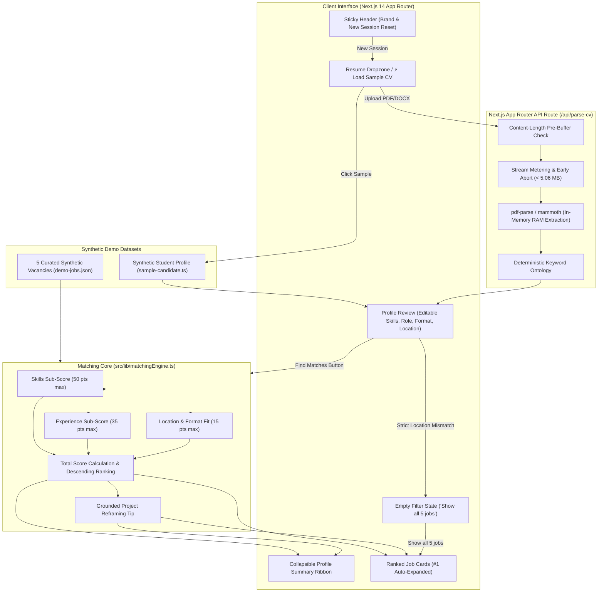

# RoleFit AI — Transparent Resume-to-Job Matching

> **Devpost Hackathon Proof of Concept** | *Build With AI: Basics*
> An explainable, privacy-first career-matching web application that replaces opaque ATS black boxes with deterministic 50/35/15 scoring, actionable skill gap analysis, and grounded CV adaptation tips.

---

## 📌 Overview & Core Problem

Every day, early-career engineers and students submit resumes to automated Applicant Tracking Systems (ATS) and receive instant, generic rejections or opaque percentage scores with zero explanation. Current AI "resume evaluators" rely on non-deterministic LLM prompts that hallucinate scores, invent fake candidate experiences, and upload private resumes to third-party cloud servers.

**RoleFit AI** solves this with a transparent, explainable alternative:
1. **Deterministic 50/35/15 Scoring:** Pure mathematical evaluation broken into Skills (50%), Relevant Projects (35%), and Location & Work Format Fit (15%). No random prompts, no guesswork.
2. **Actionable Skill Gap Breakdown:** Instant visual breakdown of matched requirements (green badges) and missing skills (amber badges).
3. **Grounded CV Adaptation Tips:** Suggests reframing an *existing* candidate project to highlight a missing skill — never hallucinates fake jobs or unverified experience.
4. **100% In-Memory Ephemeral Privacy:** Resumes uploaded as PDF or DOCX are parsed strictly in RAM and immediately released. Zero files or extracted text are written to disk, databases, or external telemetry.
5. **Instant 1-Click Evaluation:** Includes a built-in synthetic student profile and 5 realistic synthetic job listings for instant demonstration without uploading private files.

---

## 🏗 System Architecture

```
┌─────────────────────────────────────────────────────────────────────────────────┐
│                           CLIENT BROWSER (React / Next.js)                      │
│                                                                                 │
│   ┌───────────────────────────┐           ┌─────────────────────────────────┐   │
│   │   1-Click Sample CV       │           │   File Dropzone (PDF / DOCX)    │   │
│   │   (Synthetic Candidate)   │           │   (<= 5 MB Client Size Guard)   │   │
│   └─────────────┬─────────────┘           └────────────────┬────────────────┘   │
│                 │                                          │                    │
│                 │                                          ▼ HTTP POST          │
│                 │                             ┌─────────────────────────────┐   │
│                 │                             │   /api/parse-cv (RAM Only)  │   │
│                 │                             │   • Content-Length Guard    │   │
│                 │                             │   • Stream Metering (5 MB)  │   │
│                 │                             │   • pdf-parse & mammoth     │   │
│                 │                             └────────────┬────────────────┘   │
│                 │                                          │                    │
│                 ▼                                          ▼                    │
│   ┌─────────────────────────────────────────────────────────────────────────┐   │
│   │                    Candidate Profile State in Memory                    │   │
│   │       (Editable Skills Cloud, Projects, Target Role, Location/Format)   │   │
│   └────────────────────────────────────┬────────────────────────────────────┘   │
│                                        │                                        │
│                                        ▼                                        │
│   ┌─────────────────────────────────────────────────────────────────────────┐   │
│   │                 Pure Deterministic Matching Engine                      │   │
│   │                  (src/lib/matchingEngine.ts)                            │   │
│   │                                                                         │   │
│   │      Skills (50 pts)      Experience (35 pts)     Location/Format (15)  │   │
│   │     • Req: 40 pts max     • Domain: 25 pts max    • Format: 10 pts max  │   │
│   │     • Pref: 10 pts max    • Depth: 10 pts max     • Location: 5 pts max │   │
│   │                                                                         │   │
│   │              Total = min(100, max(0, round(S + E + L)))                 │   │
│   │     + Grounded CV Adaptation Tip (Project Reframing, No Hallucinations) │   │
│   └────────────────────────────────────┬────────────────────────────────────┘   │
│                                        │                                        │
│                                        ▼                                        │
│   ┌─────────────────────────────────────────────────────────────────────────┐   │
│   │                    Interactive Results Presentation                     │   │
│   │   • Sticky Navigation Header (Brand & "New Session" Instant RAM Wipe)   │   │
│   │   • Collapsible Profile Summary Ribbon ("Edit Profile" Toggle)          │   │
│   │   • Ranked Job Cards (#1 Auto-Expanded with 50/35/15 Progress Bars)     │   │
│   │   • Strict Location Filter & Empty State Recovery ("Show all 5 jobs")   │   │
│   └─────────────────────────────────────────────────────────────────────────┘   │
└─────────────────────────────────────────────────────────────────────────────────┘
```



---

## 🧮 The 50/35/15 Mathematical Scoring Engine

The scoring algorithm is implemented as a pure deterministic mathematical function in [`src/lib/matchingEngine.ts`](src/lib/matchingEngine.ts). Sub-scores are rounded to 1 decimal place; the total score is an integer clamped to $[0, 100]$.

### 1. Skills Match (50 Points Max)
- **When Preferred Skills Exist ($m > 0$):**
  - **Required Skills ($40\text{ pts max}$):**
    $$\text{Required Score} = \frac{|\text{Matched Required Skills}|}{\max(1, |\text{Total Required Skills}|)} \times 40$$
  - **Preferred Skills ($10\text{ pts max}$):**
    $$\text{Preferred Score} = \frac{|\text{Matched Preferred Skills}|}{|\text{Total Preferred Skills}|} \times 10$$
  - $\text{Skills Score} = \min(50, \max(0, \text{roundTo1Decimal}(\text{Required Score} + \text{Preferred Score})))$.
- **When No Preferred Skills Are Listed ($m = 0$):**
  - All $50\text{ pts}$ are allocated to required skills:
    $$\text{Skills Score} = \min\left(50, \max\left(0, \text{roundTo1Decimal}\left(\frac{|\text{Matched Required Skills}|}{\max(1, |\text{Total Required Skills}|)} \times 50\right)\right)\right)$$

### 2. Relevant Experience & Projects (35 Points Max)
- **Domain Alignment ($25\text{ pts max}$):**
  Each candidate project is inspected against the job's domain keywords across its title, description, and technologies.
  - Each project exhibiting domain overlap awards **$+12.5\text{ points}$**.
  - Capped at **$25\text{ points max}$** (achieved with 2 matching projects).
- **Engineering Implementation Depth ($10\text{ pts max}$):**
  Evaluated across all candidate projects combined using concrete engineering markers:
  - **$+4\text{ points}$** for API integration / external services (keywords: `api`, `fastapi`, `webhook`, `rest`).
  - **$+3\text{ points}$** for state management, data validation, schemas, or safety (keywords: `validation`, `state`, `queue`, `schema`, `safety`).
  - **$+3\text{ points}$** for testing, tooling, or workflow automation (keywords: `automation`, `workflow`, `simulator`, `pipeline`, `test`).
  - Capped at **$10\text{ points max}$**.
- $\text{Experience Score} = \min(35, \max(0, \text{roundTo1Decimal}(\text{Domain Alignment} + \text{Implementation Depth})))$.

### 3. Location & Work Format Fit (15 Points Max)
- **Work Format Match ($10\text{ pts max}$):**
  - Candidate selects `"Any"`, or candidate format matches job format (e.g. Remote to Remote, On-site to On-site, Hybrid to Hybrid): **$10\text{ points}$**.
  - Candidate selects `"Hybrid"` for a `"Remote"` job: **$8\text{ points}$**.
  - Candidate selects `"On-site"` for a `"Remote"` job: **$7\text{ points}$**.
  - All other mismatched combinations (e.g. Remote candidate for an On-site or Hybrid job): **$0\text{ points}$**.
- **Geographical Match ($5\text{ pts max}$):**
  - Job location includes `"Worldwide"` or `"Remote"`: **$5\text{ points}$**.
  - Candidate preferred location is `"Worldwide"` or empty: **$5\text{ points}$**.
  - Candidate preferred location matches or contains the job location (or vice versa): **$5\text{ points}$**.
  - Job format is `"Remote"`: **$5\text{ points}$**.
  - All other location mismatches on non-remote roles: **$0\text{ points}$**.
- $\text{Location Score} = \min(15, \max(0, \text{roundTo1Decimal}(\text{Format Score} + \text{Geographical Score})))$.

### 4. Overall Total Score
$$\text{Total Match Score} = \min(100, \max(0, \text{round}(\text{Skills Score} + \text{Experience Score} + \text{Location Score})))$$

---

## 📊 Actual Ranking for Built-In Sample Profile

When the built-in synthetic profile (`Alex Rivera`, Remote, Worldwide) is evaluated against all 5 synthetic vacancies, the engine produces the following deterministic ranking:

| Rank | Vacancy | Total Score | Skills (50) | Exp (35) | Loc/Format (15) | Matched Skills | Missing Skills |
| :---: | :--- | :---: | :---: | :---: | :---: | :--- | :--- |
| **#1** | **Junior Python Integration Developer** | **93%** | 43.3 | 35.0 | 15.0 | Python, REST APIs, SQL, Git, FastAPI | Celery, Redis |
| **#2** | **Junior AI Automation Engineer** | **90%** | 40.0 | 35.0 | 15.0 | Python, FastAPI, REST APIs, Data Validation, Git | Workflow Orchestration, Playwright, Docker |
| **#3** | **Junior Full-Stack Developer** | **83%** | 43.3 | 35.0 | 5.0 | TypeScript, React, Next.js, Node.js, Tailwind CSS, SQL | GraphQL, CI/CD |
| **#4** | **Technical Support & Product Operations** | **71%** | 43.3 | 22.5 | 5.0 | SQL, REST APIs, JavaScript, Python | Webhooks, Zendesk API |
| **#5** | **QA Automation Intern** | **55%** | 40.0 | 10.0 | 5.0 | Python, JavaScript, Git | Playwright, Selenium, Jest, Pytest |

*Note:* `Junior Python Integration Developer` takes **first place (93%)** because the candidate matches all 4 required skills (40.0 pts) plus FastAPI as a preferred skill (3.3 pts), achieves the full 35.0 experience points, and satisfies the Remote format (15.0 pts). `Junior AI Automation Engineer` takes **second place (90%)** because none of its 3 preferred skills are present in the baseline profile (0/10 pts).

---

## 💡 Grounded CV Adaptation Advice (Zero Hallucinations)

Unlike typical AI tools that generate fictional work history, RoleFit AI adheres to **strict grounding**:
1. It identifies the candidate's highest-priority missing preferred skill for the target job.
2. It locates an *existing* project in the candidate's uploaded resume that already shares technologies or domain keywords with the vacancy.
3. It generates an actionable reframing sentence:
   > *"In your **'AI Customer Response & CRM Workflow Assistant'** project, explicitly highlight your work with Python and FastAPI to directly demonstrate capability in **Celery**."*

If the candidate has no relevant project, it transparently advises authoring a focused demo project rather than inventing false bullet points.

---

## 📝 Demonstration Application Assistant & Extension Architecture

RoleFit AI includes a clearly labeled **Application Assistant** demonstration experience (`DEMO MODE — NOT SUBMITTED`) demonstrating how candidates move from transparent match scoring to preparing targeted application materials:

### What Is Implemented in the Current MVP
- **Prepare Application Entry Point:** In each expanded job card, candidates can click **"Prepare Application"** to launch the preparation assistant.
- **Grounded Cover Letter Draft:** Compiles an editable cover letter citing the candidate's real project (e.g. *"AI Customer Response & CRM Workflow Assistant"*), verified skills, and transparently acknowledging identified skill gaps without fabrication.
- **Tailored Resume Bullets:** Suggests specific bullet wording adapted from the candidate's verified projects and matching adaptation advice.
- **Interactive Preparation Checklist:** Tracks candidate readiness (reviewing skills, checking project links, confirming format alignment).
- **Strict Demo Safety Invariant:** Prominently displays `DEMO MODE — NOT SUBMITTED`. The demo workflow **cannot report a successful submission** and direct automated submission is strictly disabled (`submitApplication` returns `success: false`).

### Architectural Extension Points for Future Integrations
The application establishes a clean, typed architectural contract ([`src/types/assistant.ts`](src/types/assistant.ts)) that decouples application preparation from future submission backends:
1. **Application Preparation (`ApplicationPackage`):** Manages drafts, checklist, match breakdown, and candidate context in memory.
2. **Platform Integration Contract (`JobPlatformAdapter`):** Defines operations for future official ATS connectors (Greenhouse, Lever) or job platforms:
   - `checkAvailability(jobUrlOrId)`
   - `prepareApplication(package)`
   - `submitApplication(package)` *(Strictly disabled in demo mode)*
   - `getApplicationStatus(applicationId)`
3. **Browser Automation Extension:** A typed boundary reserved for future permitted, user-authorized browser assistants.
4. **Submission Verification:** Ensures status transitions to `submitted` are strictly gated on verified third-party API confirmations, preventing fake or unconfirmed submissions.

---

## 🌐 Target Hosting Environment & Platform Limits

> [!IMPORTANT]
> **Vercel Serverless Function Body Limit Note:**
> According to official [Vercel Function Limitations](https://vercel.com/docs/functions/limitations), Vercel's edge proxy enforces a strict **4.5 MB request body limit** across Hobby and Pro tiers.
> - For our **local Node.js demo environment** (`npm run dev` / `next start`), the API route `/api/parse-cv` supports files up to **5.0 MB** (with a 64 KB multipart overhead allowance) and uses an in-process streaming meter (`meterStream`) with explicit upstream cancellation (`reader.cancel()`) to prevent memory exhaustion.
> - When deploying to Vercel Serverless Functions, uploads of files approaching 5 MB are rejected by Vercel's gateway before reaching the function. For production Vercel deployment, files must be kept under 4.2 MB, or direct-to-cloud client upload (e.g. Vercel Blob / AWS S3 presigned URLs) must be implemented.

---

## 🧪 Synthetic Dataset Attribution & Licensing

All 5 job listings in [`src/data/demo-jobs.json`](src/data/demo-jobs.json) and the sample candidate profile in [`src/data/sample-candidate.ts`](src/data/sample-candidate.ts) are **100% synthetic mock data** created specifically for this Devpost hackathon project:
- `job_python_dev`: Junior Python Integration Developer — *DataStream Workflows (Synthetic Demo)*
- `job_ai_automation`: Junior AI Automation Engineer — *Synthetix Automations (Synthetic Demo)*
- `job_fullstack`: Junior Full-Stack Developer — *NovaStack Systems (Synthetic Demo)*
- `job_product_ops`: Technical Support & Product Operations — *CloudOps Nexus (Synthetic Demo)*
- `job_qa_intern`: QA Automation Intern — *OmniQuality Labs (Synthetic Demo)*

No real corporate databases were scraped, no live job boards were queried, and no real individuals' personal data is included.

### License Distinction
- **Application Source Code:** Released under the **MIT License** (see [`LICENSE`](LICENSE)).
- **Synthetic Datasets (`demo-jobs.json`, `sample-candidate.ts`):** Dedicated to the public domain under **Creative Commons Zero (CC0 1.0 Universal)**.

---

## 🚀 Quickstart & Verification

### Prerequisites
- Node.js 18.x or 20.x+ (tested on Node v20 & v24)
- npm 9.x or 10.x+

### Local Setup
Run directly from the project directory:
```bash
# Navigate to the project directory
cd rolefit-ai

# (Optional: if cloning from a repository, use your repository URL)
# git clone <repository-url> && cd rolefit-ai

# Install dependencies
npm install

# Start local Next.js development server
npm run dev
```
Open **`http://localhost:3000`** in your browser.

### Running Test Suites
RoleFit AI includes 5 automated test suites covering the core engine, extractor regex bounds, Slice 4 UI invariants, streaming route safety, and the Application Assistant:
```bash
# Run all 5 test suites
npm test

# Run individual suites:
npm run test:engine      # Pure 50/35/15 math, bounds, sub-scores, and ranking
npm run test:parser      # Skill extraction word boundaries (C++, C#, Go, REST APIs) and grounded projects
npm run test:slice4      # Strict location filtering, empty filter state recovery, and session reset
npm run test:api         # /api/parse-cv route: 5 MB boundaries, streaming cancel, and format validation
npm run test:assistant   # Application Assistant: grounded drafts, immutability, and submission guard
```

All 4 test suites execute and pass against the current codebase.

### Production Build
```bash
npm run build
npm run start
```

---

## 🎬 2-Minute 20-Second Demo Video Script

**Target Duration:** Exactly 2 minutes and 20 seconds (140 seconds)
**Presenter:** Solo Devpost Creator
**Screen Recording:** Browser window opened to `http://localhost:3000`

---

### Act 1: The Problem — The ATS Black Box (0:00 – 0:20) [20s]
* **Visual:** Browser showing the clean RoleFit AI homepage at `http://localhost:3000`. The sticky navigation header is visible with the tagline *"Explainable 50/35/15 Career Matching & Gap Analysis"*.
* **Voiceover:**
  > *"Every early-career developer knows the feeling: you spend hours polishing your resume, submit it online, and get an automated rejection with zero explanation. Current AI career tools aren't much better — they give you a random 'match score' from a non-deterministic chatbot with zero proof of how it got there.
  > This is **RoleFit AI** — a transparent, explainable career matching platform built for the Devpost 'Build With AI: Basics' hackathon."*

---

### Act 2: 1-Click Instant Demo & Privacy Architecture (0:20 – 0:45) [25s]
* **Visual:** Click the vibrant **"⚡ Load Sample CV"** button. The candidate profile review block animates into view with editable skill badges and project cards for "Alex Rivera".
* **Voiceover:**
  > *"To make testing instant, we provide a 1-click synthetic student profile with 12 technical skills and 3 verified projects.
  > RoleFit AI also supports real PDF and Word documents. When you drop a file, it is processed ephemerally in RAM by our Next.js API route running in-process on Node.js. We never write your resume to disk, never store it in a database, and never send your personal text to third-party logging services."*

---

### Act 3: The Explainable 50/35/15 Engine in Action (0:45 – 1:15) [30s]
* **Visual:** Click the primary teal button **"Find Matches"**. The input block smoothly collapses into a summary ribbon, and the screen scrolls down to 5 ranked job cards with the #1 vacancy auto-expanded: **Junior Python Integration Developer at 93%**, followed by **Junior AI Automation Engineer at 90%** in second place.
* **Voiceover:**
  > *"Let's click 'Find Matches'. Our profile collapses into a neat summary ribbon, and all 5 synthetic vacancies are ranked using our deterministic mathematical formula.
  > The top match — Junior Python Integration Developer at 93% — displays the exact 50/35/15 breakdown: 43.3 points for skills (matching all 4 required skills plus FastAPI as a preferred skill), a full 35 points for project depth and domain alignment, and 15 points for remote format fit. In second place, Junior AI Automation Engineer follows closely at 90%. Green badges highlight exact matches like Python, FastAPI, and REST APIs, while amber badges highlight missing preferred skills like Celery and Redis."*

---

### Act 4: Grounded Adaptation Advice & Profile Recalibration (1:15 – 1:40) [25s]
* **Visual:** Scroll down inside the expanded card to the teal callout box: *"CV Adaptation Tip"*. Then click **"Edit Profile"** in the profile summary ribbon to re-open the profile editor.
* **Voiceover:**
  > *"Notice this adaptation tip: rather than hallucinating fake experience, it analyzes Alex's existing 'CRM Workflow Assistant' project and suggests explicitly highlighting Python and FastAPI to demonstrate capability in Celery.
  > If a candidate wants to recalibrate, they can click 'Edit Profile', add new skills, tweak their preferences, and click 'Find Matches' again to recalculate scores with the updated parameters."*

---

### Act 5: Edge-Case Handling & Session Privacy Wipe (1:40 – 2:05) [25s]
* **Visual:** In the expanded Profile Review section, scroll to Target Location, type *"Tokyo"*, check the **"Strict location filter"** checkbox, and click **"Find Matches"**. The list filters down to **2 of 5 Results**, demonstrating that strict location preserves both Remote vacancies (`Junior Python Integration Developer` and `Junior AI Automation Engineer`). Next, to demonstrate edge-case recovery when no vacancies match, type *"Tokyo"* into the separate **"Filter by city / title..."** input box. The **Empty Results** card appears (*"No Vacancies Match Your Search and Location Filters"*) with the recovery button **"Show all 5 jobs"**. Click **"Show all 5 jobs"** to restore all 5 ranked vacancies. Finally, click **"New Session"** in the sticky top header.
* **Voiceover:**
  > *"We also engineered graceful edge-case handling. When we set a strict location like 'Tokyo', our engine intelligently preserves our two Remote vacancies. Then, typing 'Tokyo' into the title and city search box reduces matches to zero, triggering our Empty Results screen. Clicking 'Show all 5 jobs' resets the filters and immediately restores all five vacancies.
  > And when you're done, clicking 'New Session' in the top header instantly purges all in-memory React state, returning the application to a pristine state."*

---

### Act 6: Wrap-Up & Hackathon Vision (2:05 – 2:20) [15s]
* **Visual:** Full RoleFit AI interface returned to the initial empty state.
* **Voiceover:**
  > *"RoleFit AI proves that AI in hiring doesn't have to be opaque, predatory, or non-deterministic. By combining lightweight in-memory parsing with explainable mathematical scoring and grounded project advice, we empower job seekers to understand their fit with confidence.
  > All 4 test suites pass against the implementation. Thank you!"*

---

## 📄 License

- **Source Code:** Licensed under the [MIT License](LICENSE).
- **Synthetic Datasets:** Dedicated to the public domain under [Creative Commons Zero (CC0 1.0 Universal)](LICENSE).
