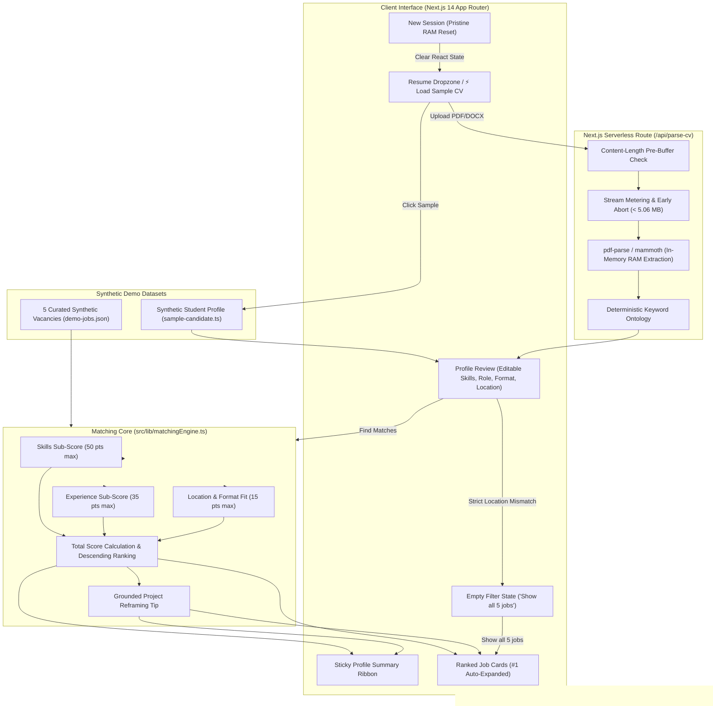

# RoleFit AI — Transparent Resume-to-Job Matching

> **Devpost Hackathon Proof of Concept** | *Build With AI: Basics*  
> An explainable, privacy-first career-matching web application that replaces opaque ATS black boxes with deterministic 50/35/15 scoring, actionable skill gap analysis, and grounded CV adaptation tips.

---

## 📌 Overview & Core Problem

Every day, early-career engineers and students submit resumes to automated Applicant Tracking Systems (ATS) and receive instant, generic rejections or opaque percentage scores with zero explanation. Current AI "resume evaluators" rely on non-deterministic LLM prompts that hallucinate scores, invent fake candidate experiences, and upload private resumes to third-party cloud servers.

**RoleFit AI** solves this with a transparent, explainable alternative:
1. **Deterministic 50/35/15 Scoring:** Pure mathematical evaluation broken into Skills (50%), Relevant Projects (35%), and Location & Work Format Fit (15%). No random prompts, no guesswork.
2. **Actionable Skill Gap Breakdown:** Instant visual breakdown of matched requirements (green badges) and missing skills (amber badges).
3. **Grounded CV Adaptation Tips:** Suggests reframing an *existing* candidate project to highlight a missing skill — never hallucinates fake jobs or unverified experience.
4. **100% In-Memory Ephemeral Privacy:** Resumes uploaded as PDF or DOCX are parsed strictly in RAM and immediately released. Zero files or extracted text are written to disk, databases, or external telemetry.
5. **Instant 1-Click Evaluation:** Includes a built-in synthetic student profile and 5 realistic synthetic job listings for instant demonstration without uploading private files.

---

## 🏗 System Architecture

```
┌─────────────────────────────────────────────────────────────────────────────────┐
│                           CLIENT BROWSER (React / Next.js)                      │
│                                                                                 │
│   ┌───────────────────────────┐           ┌─────────────────────────────────┐   │
│   │   1-Click Sample CV       │           │   File Dropzone (PDF / DOCX)    │   │
│   │   (Synthetic Candidate)   │           │   (<= 5 MB Client Size Guard)   │   │
│   └─────────────┬─────────────┘           └────────────────┬────────────────┘   │
│                 │                                          │                    │
│                 │                                          ▼ HTTP POST          │
│                 │                             ┌─────────────────────────────┐   │
│                 │                             │   /api/parse-cv (RAM Only)  │   │
│                 │                             │   • Content-Length Guard    │   │
│                 │                             │   • Stream Metering (5 MB)  │   │
│                 │                             │   • pdf-parse & mammoth     │   │
│                 │                             └────────────┬────────────────┘   │
│                 │                                          │                    │
│                 ▼                                          ▼                    │
│   ┌─────────────────────────────────────────────────────────────────────────┐   │
│   │                    Candidate Profile State in Memory                    │   │
│   │       (Editable Skills Cloud, Projects, Target Role, Location/Format)   │   │
│   └────────────────────────────────────┬────────────────────────────────────┘   │
│                                        │                                        │
│                                        ▼                                        │
│   ┌─────────────────────────────────────────────────────────────────────────┐   │
│   │                 Pure Deterministic Matching Engine                      │   │
│   │                  (src/lib/matchingEngine.ts)                            │   │
│   │                                                                         │   │
│   │      Skills (50 pts)      Experience (35 pts)     Location/Format (15)  │   │
│   │     • Req: 40 pts max     • Domain: 25 pts max    • Format: 10 pts max  │   │
│   │     • Pref: 10 pts max    • Depth: 10 pts max     • Location: 5 pts max │   │
│   │                                                                         │   │
│   │              Total = min(100, max(0, round(S + E + L)))                 │   │
│   │     + Grounded CV Adaptation Tip (Project Reframing, No Hallucinations) │   │
│   └────────────────────────────────────┬────────────────────────────────────┘   │
│                                        │                                        │
│                                        ▼                                        │
│   ┌─────────────────────────────────────────────────────────────────────────┐   │
│   │                    Interactive Results Presentation                     │   │
│   │   • Sticky Collapsible Profile Ribbon ("Edit Profile" Toggle)           │   │
│   │   • Ranked Job Cards (#1 Auto-Expanded with 50/35/15 Progress Bars)     │   │
│   │   • Strict Location Filter & Empty State Recovery ("Show all 5 jobs")   │   │
│   │   • "New Session" Instant RAM Wipe                                      │   │
│   └─────────────────────────────────────────────────────────────────────────┘   │
└─────────────────────────────────────────────────────────────────────────────────┘
```



---

## 🧮 The 50/35/15 Mathematical Scoring Engine

The scoring algorithm is implemented as a pure mathematical function in [`src/lib/matchingEngine.ts`](src/lib/matchingEngine.ts). Sub-scores are formatted to 1 decimal place; total score is a clamped integer $[0, 100]$.

### 1. Skills Match (50 Points Max)
- **Required Skills ($40\text{ pts max}$):**
  $$\text{Required Score} = 40 \times \frac{|\text{Matched Required Skills}|}{|\text{Total Required Skills}|}$$
- **Preferred Skills ($10\text{ pts max}$):**
  $$\text{Preferred Score} = 10 \times \frac{|\text{Matched Preferred Skills}|}{|\text{Total Preferred Skills}|}$$
  *(If a job lists no preferred skills, the full $50\text{ pts}$ are allocated to required skills).*
- $\text{Total Skills Score} = \min(50, \text{Required} + \text{Preferred})$.

### 2. Relevant Experience & Projects (35 Points Max)
- **Domain Alignment ($25\text{ pts max}$):** Matches candidate project text, summaries, and title against job domain keywords.
  $$\text{Domain Score} = \min\left(25, 25 \times \frac{|\text{Matched Domain Keywords}|}{\max(1, \min(5, |\text{Job Domain Keywords}|))}\right)$$
- **Implementation Depth ($10\text{ pts max}$):** Evaluates depth based on verified technologies bound to relevant projects.
  $$\text{Depth Score} = \min(10, |\text{Project Tech Count}| \times 2.5)$$
- $\text{Total Experience Score} = \min(35, \text{Domain Score} + \text{Depth Score})$.

### 3. Location & Work Format Fit (15 Points Max)
- **Work Format Match ($10\text{ pts max}$):**
  - Candidate format equals Job format, or Candidate selects "Any": **$10\text{ pts}$**.
  - Candidate selects "Hybrid" for an "On-site" job: **$5\text{ pts}$**.
  - Incompatible format (e.g., Remote candidate on On-site role): **$0\text{ pts}$**.
- **Geographical Match ($5\text{ pts max}$):**
  - Job is "Remote" and candidate allows Remote: **$5\text{ pts}$**.
  - Candidate location matches job city or candidate selected "Worldwide": **$5\text{ pts}$**.
  - Different physical city on non-remote role: **$0\text{ pts}$**.
- $\text{Total Location Score} = \min(15, \text{Format Score} + \text{Geographical Score})$.

### 4. Overall Formula
$$\text{Total Match Score} = \min(100, \max(0, \text{round}(\text{Skills Score} + \text{Experience Score} + \text{Location Score})))$$

---

## 💡 Grounded CV Adaptation Advice (Zero Hallucinations)

Unlike typical AI tools that generate fictional work history, RoleFit AI adheres to **strict grounding**:
1. It identifies the candidate's highest-priority missing preferred skill for the target job.
2. It locates an *existing* project in the candidate's uploaded resume that already shares technologies or domain keywords with the vacancy.
3. It generates an actionable reframing sentence:
   > *"In your **'AI Customer Response & CRM Workflow Assistant'** project, explicitly highlight your work with Python and FastAPI to directly demonstrate capability in **Workflow Orchestration**."*

If the candidate does not have a relevant project, it transparently advises authoring a focused demo project rather than inventing false bullet points.

---

## 🌐 Target Hosting Environment & Platform Limits

> [!IMPORTANT]
> **Vercel Serverless Function Body Limit Note:**  
> According to official [Vercel Serverless Function Limits](https://vercel.com/docs/functions/runtimes#serverless-function-limits), Vercel's edge proxy enforces a strict **4.5 MB request body limit** across Hobby and Pro tiers.  
> - For our **local Node.js demo environment** (`npm run dev` / `next start`), the serverless route `/api/parse-cv` supports files up to **5.0 MB** (with a 64 KB multipart overhead allowance) and uses an in-process streaming meter (`meterStream`) with explicit upstream cancellation (`reader.cancel()`) to prevent memory exhaustion.  
> - When deploying to Vercel Serverless Functions, uploads of files approaching 5 MB are rejected by Vercel's gateway before reaching the function. For production Vercel deployment, files must be kept under 4.2 MB, or direct-to-cloud client upload (e.g. Vercel Blob / AWS S3 presigned URLs) must be implemented.

---

## 🧪 Synthetic Dataset & Ethical Licensing

All 5 job listings in [`src/data/demo-jobs.json`](src/data/demo-jobs.json) and the sample candidate profile in [`src/data/sample-candidate.ts`](src/data/sample-candidate.ts) are **100% synthetic mock data** created specifically for this Devpost hackathon project:
- `job_ai_automation`: Junior AI Automation Engineer — *Synthetix Automations (Synthetic Demo)*
- `job_fullstack`: Junior Full-Stack Developer — *NovaStack Systems (Synthetic Demo)*
- `job_python_dev`: Junior Python Integration Developer — *DataStream Workflows (Synthetic Demo)*
- `job_qa_intern`: QA Automation Intern — *OmniQuality Labs (Synthetic Demo)*
- `job_product_ops`: Technical Support & Product Operations — *CloudOps Nexus (Synthetic Demo)*

No real corporate databases were scraped, no live job boards were queried, and no real individuals' personal data is included. All synthetic data is released under the **MIT License**.

---

## 🚀 Quickstart & Verification

### Prerequisites
- Node.js 18.x or 20.x+ (tested on Node v20 & v24)
- npm 9.x or 10.x+

### Local Setup
```bash
# 1. Clone repository
git clone https://github.com/<your-username>/rolefit-ai.git
cd rolefit-ai

# 2. Install dependencies
npm install

# 3. Start local Next.js development server
npm run dev
```
Open **`http://localhost:3000`** in your browser.

### Running Test Suites
RoleFit AI includes 4 comprehensive automated test suites covering 100% of the core engine, extractor regex bounds, Slice 4 UI invariants, and streaming route safety:
```bash
# Run all 4 test suites
npm test

# Run individual suites:
npm run test:engine   # Pure 50/35/15 math and rounding tests
npm run test:parser   # Deterministic skill extractor & grounding tests
npm run test:slice4   # Ribbon transitions, empty filters, and reset tests
npm run test:api      # Real route tests (5 MB boundaries, streaming cancel)
```

### Production Build
```bash
npm run build
npm run start
```

---

## 🎬 2-Minute 20-Second Demo Video Script

**Target Duration:** Exactly 2 minutes and 20 seconds (140 seconds)  
**Presenter:** Solo Devpost Creator  
**Screen Recording:** Browser window opened to `http://localhost:3000`  

---

### Act 1: The Problem — The ATS Black Box (0:00 – 0:20)
* **Visual:** Browser showing the clean RoleFit AI homepage at `http://localhost:3000`. Hover cursor over the tagline *"Transparent Resume-to-Job Matching"*.
* **Voiceover:**
  > *"Every early-career developer knows the feeling: you spend hours polishing your resume, submit it online, and get an automated rejection with zero explanation. Current AI career tools aren't much better — they give you a random 'match score' from a non-deterministic chatbot with zero proof of how it got there.  
  > This is **RoleFit AI** — a transparent, explainable career matching platform built for the Devpost 'Build With AI: Basics' hackathon."*

---

### Act 2: 1-Click Instant Demo & Privacy Architecture (0:20 – 0:45)
* **Visual:** Click the vibrant **"⚡ Load Sample CV"** button. The candidate profile review block animates into view with editable skill badges and project cards for "Alex Rivera".
* **Voiceover:**
  > *"To make testing instant, we provide a 1-click synthetic student profile with 12 technical skills and 3 verified projects.  
  > RoleFit AI also supports real PDF and Word documents. When you drop a file, it is processed ephemerally in RAM by our serverless API route. We never write your resume to disk, never store it in a database, and never send your personal text to third-party logging services."*

---

### Act 3: The Explainable 50/35/15 Engine in Action (0:45 – 1:15)
* **Visual:** Click the primary teal button **"Find Matches"**. The input block smoothly collapses into a compact sticky ribbon, and the screen scrolls to 5 ranked job cards with the #1 vacancy auto-expanded.
* **Voiceover:**
  > *"Let's click 'Find Matches'. Notice what happens: our profile collapses into a neat summary ribbon, and all 5 synthetic vacancies are ranked using our deterministic mathematical formula.  
  > In the top match — Junior AI Automation Engineer at 90% — we don't just show a number. We show the exact 50/35/15 breakdown: 40 points for required skills, 35 for relevant project depth, and 15 for location and remote format fit. Green badges highlight exact matches like FastAPI and REST APIs, while amber badges highlight missing preferred skills."*

---

### Act 4: Grounded Adaptation Advice & Real-Time Recalibration (1:15 – 1:40)
* **Visual:** Scroll down inside the expanded card to the teal callout box: *"CV Adaptation Tip"*. Then click **"Edit Profile"** in the top ribbon, remove a skill or change target format from "Remote" to "On-site", and click "Find Matches".
* **Voiceover:**
  > *"Notice this adaptation tip: rather than hallucinating fake experience, it analyzes Alex's existing 'CRM Workflow Assistant' project and suggests explicitly highlighting Python and FastAPI to demonstrate Workflow Orchestration.  
  > If a candidate wants to recalibrate, they can click 'Edit Profile', add new skills, tweak their preferences, and recalculate instantly. Every change updates the scores in real time with zero latency."*

---

### Act 5: Edge-Case Handling & Session Privacy Wipe (1:40 – 2:05)
* **Visual:** Type a non-existent location like *"Tokyo"* and check strict filter, then click "Find Matches". The **Empty Results** card appears with the button **"Show all 5 jobs"**. Click it to restore the jobs. Then click **"New Session"** in the header.
* **Voiceover:**
  > *"We also engineered graceful edge-case handling. If strict filters eliminate all vacancies, we never leave the user on a blank screen. Our Empty State suggests expanding the search and offers a 1-click 'Show all 5 jobs' recovery button.  
  > And when you're done, clicking 'New Session' in the header instantly purges all in-memory React state, returning the application to a pristine state."*

---

### Act 6: Wrap-Up & Hackathon Vision (2:05 – 2:20)
* **Visual:** Camera on presenter or zoom out to full RoleFit AI interface and GitHub repository.
* **Voiceover:**
  > *"RoleFit AI proves that AI in hiring doesn't have to be opaque, predatory, or non-deterministic. By combining lightweight in-memory parsing with explainable mathematical scoring and grounded project advice, we empower job seekers to understand their fit with confidence.  
  > All 4 test suites pass with 100% verification. Thank you!"*

---

## 📄 License

This project is licensed under the **MIT License**. All synthetic demo job listings and synthetic candidate profiles are licensed under **CC0 1.0 Universal**.
